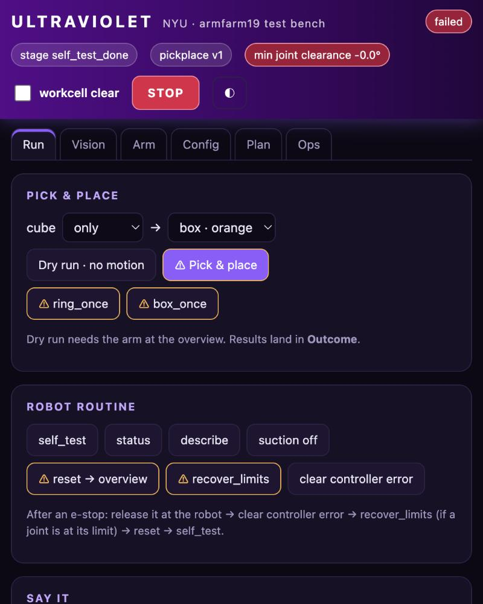

# Ultraviolet test bench

A local page for testing and configuring armfarm19 by hand, so you don't need to write code to
debug.

```bash
make setup        # once
make dashboard    # then open http://localhost:8765
```

It uses your own `viam login`; the machine key stays in the server process and never reaches the
browser.



| Tab | What you can do |
|---|---|
| **Run** | Pick & place builder (cube left/right/nearest… → ring or any box); dry run; `ring_once` / `box_once`; `self_test`, `status`, `describe`, suction off, reset, recover_limits, clear controller error; *Say it* (plain language → command); raw DoCommand box; outcome card (including the vision pickup check); event timeline |
| **Vision** | Wrist-camera snapshot or 1 fps live view, with detection overlay; `measure_box` → candidate → *Add candidate to config* |
| **Arm** | Joint table with limit-clearance bars and ± jogs; stop arm; suction on/off; vacuum wiring test (contact vs plugin); xArm `get_state` / `get_error` / `clear_error` |
| **Config** | Tuning form for every key (blank = default); box table with fit gaps, *centre* and *remove*; raw attributes editor |
| **Plan** | Live planner check from the overview or the current pose, with a what-if ring position. Shows a per-stage table with J4 range. Plan only: nothing moves |
| **Ops** | Running module version, recent builds with *run this*, upload + cloud build of this checkout, robot logs with a filter |

Safety:
- Buttons marked ⚠ move the arm or switch suction on. They need the *workcell clear* box ticked,
  and the server refuses them while code-2 is busy.
- Jogs are direct joint moves without collision checking (≤ 10°, ≤ 5°/s).
- **STOP** cancels code-2's command and stops the arm. It is a software stop; keep the e-stop in reach.
- Config and version changes restart code-2 and ask for confirmation.

Keyboard and accessibility: use Tab to reach the screen tabs, Left/Right or Home/End to focus a tab, and Enter/Space to open it. Hold the microphone button with mouse/touch, or use Enter/Space to start and stop listening. Listening stops when leaving Run or hiding the browser tab. Errors are announced to screen readers and stay visible until dismissed; Dismiss returns keyboard focus to the originating control. Joint buttons and form fields have accessible labels. On narrow screens, panels stack and wide tables scroll within their own region.

Tests (`make test-dashboard`) run the server against a fake robot. They check the safety gates,
allowlists and config helpers.
